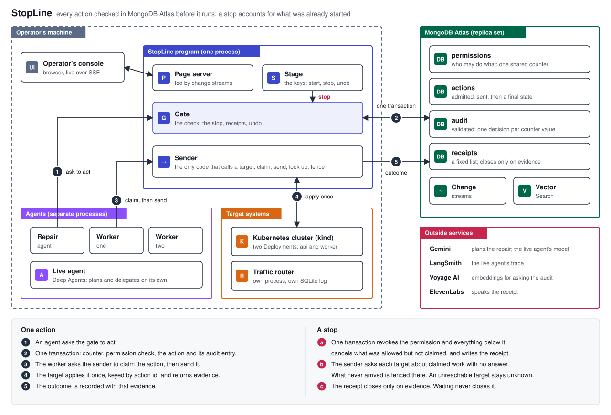

# StopLine

StopLine stops a group of AI agents mid-run and accounts for every action they had already started. Every action is checked in MongoDB Atlas before it runs. A stop cancels what was allowed but not sent yet, and writes a receipt of everything that was. The receipt closes only when each target system gives evidence of what happened.

Built in one day for the **Agents You Can Audit** statement at Agents in Context Toronto, a MongoDB hackathon, on 14 November 2026.



## What I found

I ran the same repair job with the stop placed at every point of every step, in both worker orders: 43 schedules, on the real check in Atlas and a real router process.

| How the agents are stopped | Schedules where an action started after the stop (of 43) |
| :-- | --: |
| A stop flag each worker reads before a step | 20 |
| StopLine, first version | 8 |
| **StopLine** | **0** |

- **Why a flag fails.** A worker reads the flag, then acts after someone pressed stop. A flag also keeps no record of what was already on its way. Press `1`, then `S`, to watch a restart land on a Kubernetes Deployment a second after the stop.
- **Why the first version let 8 through.** A worker could claim an action just before the stop and send it just after. Every one of the 8 was on the receipt, but they still ran. I added a sweep: right after a stop, StopLine asks each target about anything claimed that has no answer yet, and fences what never arrived so a late send is refused there. That took 8 to 0. Across the run the sweep fenced 9 actions and found 8 already at their target.
- **In flight.** 1 action was already on its way when the stop committed, and landed after it. It is on the receipt. StopLine does not pull back what has already reached a target.
- **Random stops.** A soak test stops 12 runs at a random moment and checks each receipt against the targets' own logs.
- **Fences.** I raced a send against a fence 200 times per target. Exactly one of them wins every time.
- **Speed.** One shared counter per grant means about one action every 1.5 seconds per permission tree, from a laptop about 85 ms from the cluster. That suits a bounded tree (16 permissions here).

## How it works

**`gate/` (the check and the stop).** A permission is a document: who granted it, to whom, for which tools and targets, with what limits, until when. A parent agent hands a narrower permission to a worker. MongoDB transactions conflict on writes and never on reads, so every check, hand-down and stop increments one counter on the root permission inside its transaction. Two of them can never both commit from the same snapshot; the driver retries the loser, which then sees the new state. An allowed action is claimed with a conditional update before it is sent, and the stop cancels whatever nobody claimed. The receipt covers a fixed list: everything allowed before the stop's counter value.


**`targets/` (what the agents act on).** Two Deployments in a local Kubernetes cluster, where a rollback or a restart is one patch that also writes the action's id onto the Deployment, so the cluster's own history is the evidence. A traffic router I wrote for this, with its own process, its own SQLite store and a log keyed by action id; it can be cut off in the middle of a call. A mock cluster sits behind the same interface for tests. Workers get no access to the targets. Only the sender does.

**`agents/` and `deep/` (the agents).** A repair agent plans from the incident and a runbook (a language model when a key is set, a saved plan otherwise) and hands permissions to two workers, which run as separate processes and can be killed and resumed. Key `3` runs a live agent built with Deep Agents: it plans and delegates on its own, every tool call goes through the same check, and its LangSmith trace carries the check's decision on each call.

**`view/`, `report/`, `search/`, `voice/` (for the person watching).** An operator's console fed by change streams, with every earlier run saved. A reviewer's report that rebuilds a run from the stored records and re-checks seven guarantees, including that the decision counters have no gaps. "Ask the audit": a plain question answered with stored audit entries, found with Atlas Vector Search over Voyage embeddings. A spoken receipt through ElevenLabs.

The audit collection has a `$jsonSchema` validator with rules per kind of entry, and a unique index so no two decisions share a counter value. `$graphLookup` finds everything below a stopped permission. Every decision is stamped with the server's time.

## Run it

Needs Python 3.12, [uv](https://docs.astral.sh/uv/) and a MongoDB Atlas cluster. The real cluster target also needs Docker, kind and kubectl.

```sh
uv sync
export MONGODB_URI='<your connection string>'   # or a line MONGODB_URI='...' in ~/.stopline_env

# with the real cluster target
kind create cluster --name stopline
docker pull alpine:3.17
demo-app/build.sh
k8s/up.sh
uv run python -m stopline            # then open http://127.0.0.1:8785

# or with no cluster
uv run python -m stopline --cluster mock

# optional
uv run python -m stopline --model    # a language model plans the repair (GEMINI_API_KEY)
uv run python -m stopline --voice    # speaks the receipt (ELEVENLABS_API_KEY, macOS)
uv sync --extra agent                # the live agent behind key 3; LANGSMITH_API_KEY turns its trace on
```

| Key | What it does |
|---|---|
| `1` | Baseline run: workers read a stop flag |
| `2` | StopLine run: every action passes the check |
| `3` | Live agent run, through the same check |
| `S` | Stop |
| `K` | Cut the router off mid-call and kill worker two |
| `W` | Resume worker two from its saved plan |
| `R` | Restore the router and settle what is unknown |
| `U` | Undo what has an inverse |
| `X` | Worker two asks for 90%, over its 50% limit, and is refused |
| `V` | The database rejects a malformed audit entry |
| `M` | The measured numbers |
| `P` | The reviewer's report |
| `T` | The live agent's trace in LangSmith |
| `/` | Ask the audit (VOYAGE_API_KEY) |
| `F` | Stage mode, for a projector |

The page says which key it is ready for. The usual order is `1 S`, then `2 K S W R U`.

```sh
scripts/test-all.sh                                               # every test directory
STOPLINE_E2E_CLUSTER=kind uv run pytest tests/e2e -o addopts=""   # both runs, end to end, on the real cluster
uv run python -m stopline.proof --out results.json                # the 43 schedules
```

Tests create their own databases and drop them. Two tests call a live language model and run only with `STOPLINE_LIVE=1`.

## Limits

- An action that already reached its target stays done. StopLine lists it and proves its outcome.
- Expiry is judged by the server's clock when the action is checked. The target may act later.
- Only tools that go through the check are covered.
- The router is a test system, and the scripted runs hold a worker at a named point so the same thing happens every time. The page labels a held step. The live agent run has no holds.
