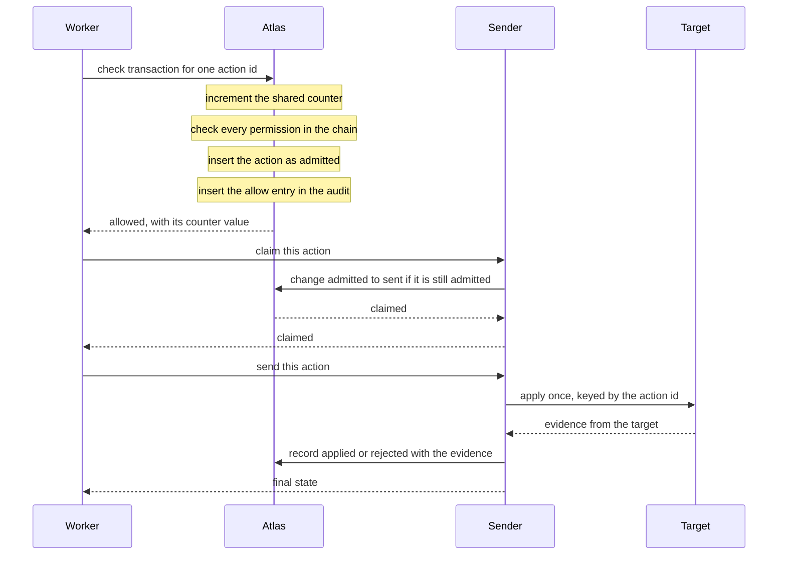
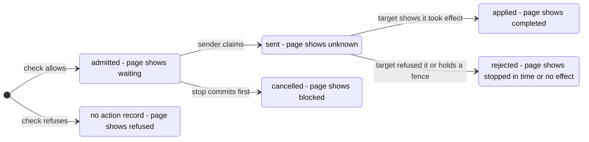
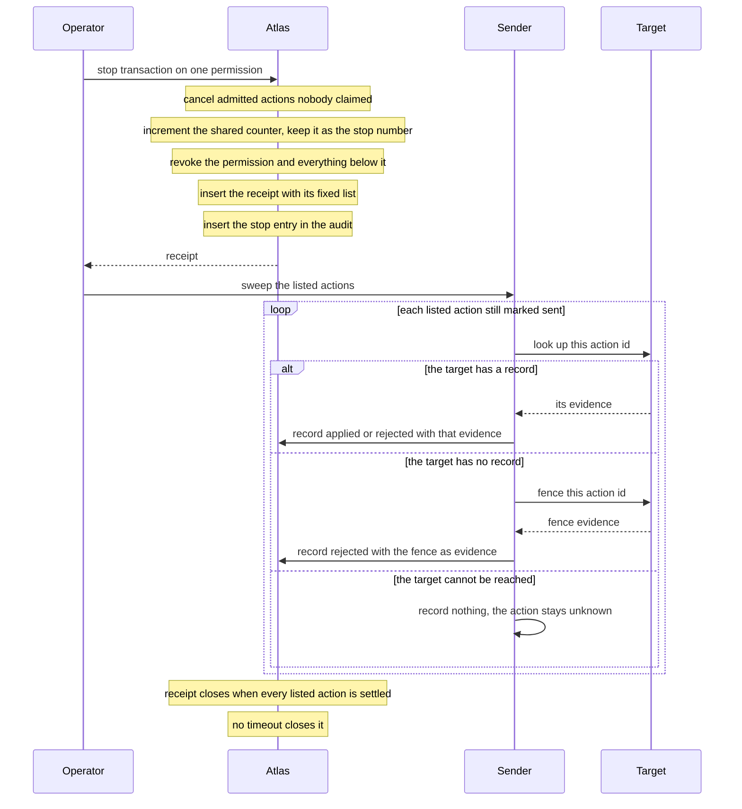

# StopLine

- **Problem.** A stop flag cannot stop a worker that has already read it, and it records nothing about work under way.
- **Guarantee.** After a stop commits, nothing new is allowed under the stopped permission, and every action allowed earlier is on a receipt that closes only on evidence.
- **Real in the demo.** A local Kubernetes cluster, a separate router process and a real MongoDB Atlas cluster.

Built in one day, Saturday 14 November 2026, at Agents in Context Toronto (a MongoDB hackathon), for the problem statement "Agents you can audit".

## The problem

An agent that hands work to other agents is hard to stop. The usual answer is a stop flag that each worker reads before its next step. Press `1`, then `S`, to watch it fail: a restart lands on a Kubernetes Deployment one second after the stop.

## What StopLine does

- **Permission is data in Atlas.** A permission records who granted it, to whom, for which tools and targets, with what limits, until when. A parent agent hands a narrower permission to a worker.
- **Every action passes one check in Atlas before it runs.** An allowed action's record and its audit entry commit in one transaction. A refusal writes only an audit entry.
- **Stop** revokes a permission and everything handed down from it. In the same transaction it cancels work that was allowed but not yet claimed, and writes a receipt listing every action allowed before it.
- **The receipt closes only on evidence.** An action that was sent and never answered stays "unknown". StopLine asks the target about that action by its id. If the target applied it, that is recorded. If it has no record, StopLine places a fence for that id so a late arrival is refused, and records that it had no effect.
- **Undo** is a new action that reverses an earlier one, through the same check, under the permission of the person who stopped the run. Actions with no inverse are marked "no undo".
- **A reviewer's report** rebuilds a whole run from the stored records and re-checks seven guarantees.
- **An operator's console** shows the run as it happens, keeps every earlier run to open again, and can be asked about the audit trail in plain words.
- **A live agent** built with Deep Agents runs through the same check. Stop it mid-run and its next tool call is refused.

One action:



Its states, in the page's words:



## How the stop is made exact

1. **One shared counter per grant.** MongoDB transactions conflict only on writes, so reading "my parent is still active" protects nothing. Every check, hand-down and stop increments one counter on the root permission document inside its transaction. Two of them cannot both commit from the same snapshot. The driver retries the loser, which then sees the new state.
2. **Claim before send.** An action is allowed, then claimed with a conditional update on its own document, then sent. The stop cancels every allowed-but-unclaimed action in its transaction, so a claim and a stop conflict on that document.
3. **A receipt covers a fixed list.** The stop takes a sequence number from the shared counter. The receipt covers every action allowed under the stopped permissions before that number, and closes when each one is applied, shown to have had no effect, or cancelled.
4. **A sweep follows the stop.** Work that was claimed but had not reached its target is fenced there, so a late send is refused. Work whose target cannot be reached stays unknown.



`tests/sandbox` checks the database behaviour this rests on. `tests/gate` and `tests/concurrency` hold the named interleavings.

## MongoDB features used

Multi-document transactions with snapshot reads and majority writes, the driver's `with_transaction` retry, `$graphLookup` to find everything below a permission, a `$jsonSchema` validator on the audit collection, a unique index on decision counters, Atlas Vector Search over audit entries, pipeline updates with `$$NOW` so every decision carries the server's time, and change streams that feed the page and tell workers to halt early.

## What the agents act on

- **A Kubernetes cluster.** Two Deployments in a local kind cluster. A rollback or a restart is one patch that also writes the action's id onto the Deployment, so the cluster's own history is the evidence. StopLine workers get no target adapter. Only the sender calls a target.
- **A traffic router** written for this project: its own process, its own SQLite store, a log keyed by action id. It can be cut off in the middle of a call.
- A mock cluster behind the same interface, for tests and as a fallback.

## Run it

Needs Python 3.12, [uv](https://docs.astral.sh/uv/), and a MongoDB Atlas cluster (any replica set). The real cluster target also needs Docker, kind and kubectl.

```sh
uv sync
export MONGODB_URI='<your connection string>'   # or a line MONGODB_URI='...' in ~/.stopline_env

# real cluster target
kind create cluster --name stopline
docker pull alpine:3.17                     # the image build needs it and will not pull it
demo-app/build.sh
k8s/up.sh
uv run python -m stopline                   # then open http://127.0.0.1:8785

# or, with no cluster
uv run python -m stopline --cluster mock

# optional: the live agent behind key 3 (Deep Agents, a Gemini, Anthropic or OpenAI key; LANGSMITH_API_KEY turns tracing on)
uv sync --extra agent

# optional flags
uv run python -m stopline --voice           # speaks the receipt aloud (needs ELEVENLABS_API_KEY)
uv run python -m stopline --model           # a language model proposes the repair (needs GEMINI_API_KEY).
                                            # The check decides what may run, and a proposal outside
                                            # the agreed four steps is replaced by the saved plan.

# or one script: stops whatever listens on ports 8785 and 8766, clears earlier
# runs from the database, starts the demo and opens the page
scripts/demo.sh                             # real cluster, once the kind cluster exists
scripts/demo.sh mock                        # no Docker needed

scripts/play.sh                             # presses the keys on a timer, for a one-minute recording
uv run python -m stopline.report --out run.html   # the reviewer's report for the latest run
```

| Key | What it does |
|---|---|
| `1` | Baseline run: workers read a stop flag |
| `2` | StopLine run: every action passes the check |
| `3` | Live agent: a language-model agent (Deep Agents) makes the repair, and every tool call passes the same check |
| `S` | Stop |
| `K` | Cut the router off mid-call and kill worker two |
| `W` | Resume worker two from its saved plan |
| `R` | Restore the router and settle what is unknown |
| `U` | Undo what has an inverse |
| `V` | Show the database rejecting a malformed audit entry |
| `M` | The measured numbers |
| `P` | Open the reviewer's report |
| `X` | Worker two asks for 90%, over its 50% limit, and is refused |
| `T` | Open the live agent's trace in LangSmith; each tool call there carries the check's decision |
| `F` | Stage mode: larger rows, no side rail, for a projector |
| `/` | Ask the audit: finds stored entries by meaning, writes no answer (needs `VOYAGE_API_KEY`) |

```
               the page says which key it is ready for
1 S            baseline: the restart runs after the stop
2 K S W R U    StopLine: the receipt opens with one action unknown, the resumed worker
               is refused, the router's evidence closes the receipt, the shift is undone
               (the rollback has no undo)
2 S            the sweep: the claimed 25% shift is fenced at the router and shows as
               STOPPED IN TIME
```

## Tests

```sh
scripts/test-all.sh                                   # every test directory
uv run pytest tests/e2e -o addopts=""                 # both demo runs, end to end
STOPLINE_E2E_CLUSTER=kind uv run pytest tests/e2e -o addopts=""   # the same on the real cluster
uv run pytest tests/soak -s -o addopts=""             # stops at random moments, checked against receipts and targets
```

Tests create their own databases and drop them. Two tests call a live language model; they run only with `STOPLINE_LIVE=1`.

## What was measured

```sh
# a fixed list of named stop schedules, each run once with a stop flag and once with StopLine,
# on the real check in Atlas and a real router process, with the mock cluster and a scripted driver
uv run python -m stopline.proof --out results.json
```

- 43 schedules. An action started after the stop in 20 with the stop flag and in 0 with StopLine.
- 1 action was in flight (sent before the stop, landed after it). It is on its receipt.
- Across the run the sweep fenced 9 actions that had not arrived, and found 8 already at their target.
- Before the sweep existed the same run measured 8 of 43 for StopLine: a worker could claim just before the stop and send after it. The sweep was added in response.
- A soak test stops 12 runs at random moments and checks each receipt against the targets' own logs.
- Sends race fences 200 times per target: in every trial exactly one of them wins.
- The end-to-end test of both demo runs passes on the real cluster and the mock.
- 30 concurrency tests drive two or three sessions through named interleavings.

## Limits

- An action sent before the stop can still land after it. StopLine lists it and proves its outcome. It does not pull it back.
- Expiry is judged by the server's clock when the action is checked. The target may act later.
- The shared counter is a deliberately hot document: about one action every 1.5 seconds per permission tree, measured from a laptop about 85 ms from the cluster. It suits a bounded tree of 16 permissions under one grant.
- Only tools that go through the check are covered.
- The router is a test system, and the demo's timing is controlled by a test schedule that holds a worker at a named point. The page labels a held step.

## Layout

```
src/stopline/contract.py         shared names, record shapes, interfaces
src/stopline/db.py               the one place that opens a connection; run_transaction
src/stopline/gate/core.py        the check (admit), claim, stop, record_outcome, receipt
src/stopline/gate/schema.py      the audit validator and the policy text
src/stopline/gate/compensate.py  undo
src/stopline/targets/sender.py   claim, send, reconcile, sweep
src/stopline/targets/kube.py     the Kubernetes adapter: patch, lookup, fence
src/stopline/targets/router.py   the router process; router_store.py is its SQLite log
src/stopline/targets/mock.py     the mock cluster
src/stopline/agents/             repair agent, workers, the stage behind the page's keys
src/stopline/wire.py             how a worker process reaches the sender over HTTP
src/stopline/view/               the page
src/stopline/proof/              the schedule runner behind the numbers
src/stopline/report/             the reviewer's report; checks.py holds the seven checks
src/stopline/search/             ask the audit: embeddings and vector search over audit entries
src/stopline/voice/              spoken receipt
src/stopline/llm.py              language-model planner
src/stopline/deep/               the live agent: tools that go through the check, and its trace
src/stopline/app.py              wires it together
scripts/                         demo.sh, play.sh, test-all.sh
k8s/, demo-app/                  the cluster target
tests/                           one directory per part; e2e drives both demo runs,
                                 fence races a send against a fence for one id,
                                 soak stops runs at random moments
```
